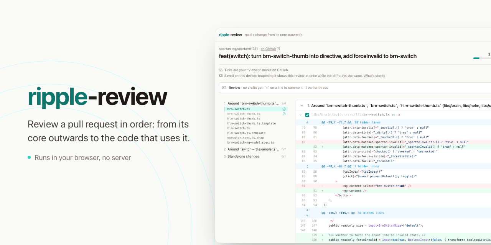

# ripple-review

Suggests the order in which to review a change: from its core (contracts,
schema, domain) out to its consumers, split into stories, with mechanical
edits and generated files set aside. Alphabetical file lists put consumers
(`apps/…`) before what they consume (`libs/…`); this fixes that.



```sh
bun install
bun ripple owner/repo#123                   # GitHub PR (GitHub's API)
bun ripple https://github.com/o/r/pull/123
bun ripple --repo ../app --base main        # local branch vs. main
bun ripple --fixture apps/cli/fixtures/spartan-1741   # a recorded change
  --format json   # machine-readable
  --debug         # dump edges and roles to stderr
  --record <dir>  # save the change (diff + files read) as a fixture
```

GitHub PRs are read through GitHub's API with your token (`GITHUB_TOKEN`,
`GH_TOKEN`, or the GitHub CLI's `gh auth token`): the diff, the tree at head
and the files the analysis needs, many per request.

## Web app

```sh
bun dev    # http://localhost:4200
```

The same review in the browser: groups with their files and diffs, ticks
per file, "Refine with AI". On GitHub, the ticks are your "Viewed" marks
on the pull request, both ways, and you can review there: comment on a
line, a range of lines or a file (drafts go into your pending review on
GitHub, which only you see until you submit), then submit with a summary
as a comment, an approval or a request for changes; the pull request's
existing threads show next to their lines. Both need a token with write
access to pull requests; without it, ticks and drafts stay in the browser
until it has. There is no server: the engine runs in a Web
Worker in your browser and calls GitHub (and, for the AI, Anthropic)
directly with the token and key you enter under Settings. They, your ticks
and the contents of files already read stay in the browser (IndexedDB;
Settings lists them and deletes them one by one), so
a later pull request of the same repository fetches only what changed.

## How it works

```
source (libs/forge-github | libs/sources: local git, fixture) ──► ChangeSet: diff + head snapshot
                                        │
adapters (libs/adapter-*) ─────► ModuleFacts per file: imports, re-exports,
                                   exports, definitions (names)
framework rules (libs/frameworks) ► per file, for the frameworks the repository
                                   uses: parts, files to read first, names
                                        │
core (libs/core, language-agnostic)
  graph.ts      edges between changed files
                  import    – symbols followed through barrels to their defining file
                  contains  – includes (psql `\i`, graphile-migrate `--! include`)
                  framework – a framework's convention (a blueprint before its model)
                  name      – a diff mentions a distinctive name another changed
                              file defines (SQL fn ↔ TS caller, GraphQL type ↔ resolver)
  classify.ts   role per file: docs, schema, contract, source, wiring, config,
                test-support, test, generated (.gitattributes, headers, paths), lockfile
  mechanical.ts "same small edit in many files" groups
  community.ts  Louvain clustering → stories
  order.ts      story order (dependencies, heavier direction wins in cycles),
                file order inside a story (topological, tests last),
                generated files bridged (SQL → generated types → TS caller)
                                        │
report (libs/report)  Markdown checklist (with GitHub file links) or JSON
```

### Adding a language

Create `libs/adapter-<lang>` implementing `LanguageAdapter`
(`libs/core/src/model.ts`), register it in `libs/engine/src/adapters.ts`, add
its path to the root `tsconfig.json`, and run the shared contract suite
(`adapterContract` in `libs/core/src/testing/adapter-contract.ts`) from its
tests. An adapter imports from
`@ripple-review/core` only. It provides:

- `supports(path)`: which files it handles
- `parse(path, content)`: imports, re-exports, exports and the names it defines
- `resolve(specifier, from)`: specifier → repository path (or `undefined` if external)
- `roleHint(path)` (optional), e.g. "schema" for migrations

Everything else (barrel following, name links, clustering, ordering) is shared.
Name links work across languages even without an adapter for the mentioning
file's language.

### Frameworks

Rules for the frameworks a repository uses, detected from its layout and
`package.json`:

- **graphile-migrate**: a migration is made of the fixtures it includes.
- **graphile-worker**: a task file is named by its basename, so what queues
  it links to it.
- **PostGraphile**: SQL tables, views and functions define their GraphQL
  names (both inflections, computed columns, `@name`).
- **Angular**: a component's template and styles are its parts; selectors
  and bindings link templates to components.
- **Kirby**: a file's name is its key: blueprints by id and `extends`,
  templates and blocks named in blueprints and PHP, a page's blueprint
  before its model, controller and template, snippets and collections.

### Adding a framework

What a framework always does the same way (a migration inlines its
fixtures, a task is queued by its file name, a template belongs to its
component) goes in a rule: a folder `libs/frameworks/src/<id>/` (the rule
and its tests) implementing
`FrameworkRule` (`libs/core/src/framework.ts`), listed in
`frameworkRules()` (`libs/frameworks/src/index.ts`). It provides:

- `detect(ctx)`: whether the repository uses the framework, from paths and
  from files the analysis reads anyway (`package.json`; recorded fixtures
  keep only the files read; `packagesUsing` in `src/manifests.ts` finds
  the packages depending on something)
- `file({ path, content, facts })`: for one changed file, the `parts` it is
  made of, the files to read before it (`dependsOn`, with how they relate)
  and the names others mention it by (`definitions`)
- `roleHint(path)` (optional), consulted after the adapter's

Rules infer from layout and names rather than reading a configuration in
the reviewed repository, and run in the browser (no `node:` imports).

## Development

Nx workspace on Bun, Biome for lint and format, lefthook for git hooks
(`bun install` sets them up). See `CLAUDE.md` for the layout and rules.

```sh
bunx nx run-many -t typecheck test:unit   # or: bunx nx affected -t …
bunx biome check --write .
bunx nx run @ripple-review/web:shots      # screenshots and a 1280×640 cover
```

The screenshots (`apps/web/shots/`) show the real production build, with
GitHub's API answered from a recorded fixture: no token, the same pictures
every time. Playwright needs its browser once:
`cd apps/web && bunx playwright install chromium`.

Tests run offline: recorded PRs in `apps/cli/fixtures/` (`--record`) replay
against a golden `expected.md` of their review order. An example of the
output: [`examples/spartan-1741.md`](examples/spartan-1741.md).

Recordings of private repositories go to `local/fixtures/` instead
(gitignored); the tests run them too when they are there. The same goes for
the evaluation corpus (`bun corpus`, `local/corpus/`).

## Status / next steps

- [x] CLI: TypeScript/JS, SQL, GraphQL adapters
- [ ] More adapters: Python, Go, Java/Kotlin (tree-sitter), C#, Rust
- [ ] AI layer: name the stories, place files the graph can't (config, docs),
      reconsider weak links; input is the graph + stats + trimmed hunks
- [ ] GitHub App: post the order as a sticky PR comment (links already point
      to the PR's file anchors)
- [ ] Evaluate on a corpus of PRs (does the order feel right?)
- [ ] Very large repos: prefetch only what's reachable instead of all source files

## License

[Functional Source License 1.1, MIT Future License](LICENSE.md)
(FSL-1.1-MIT): use, change and share it for anything but a competing
commercial product or service; each version becomes MIT two years after
its release. The recorded fixtures in `apps/cli/fixtures/` are excerpts of
other projects under their own licenses (a `LICENSE` file in each).
